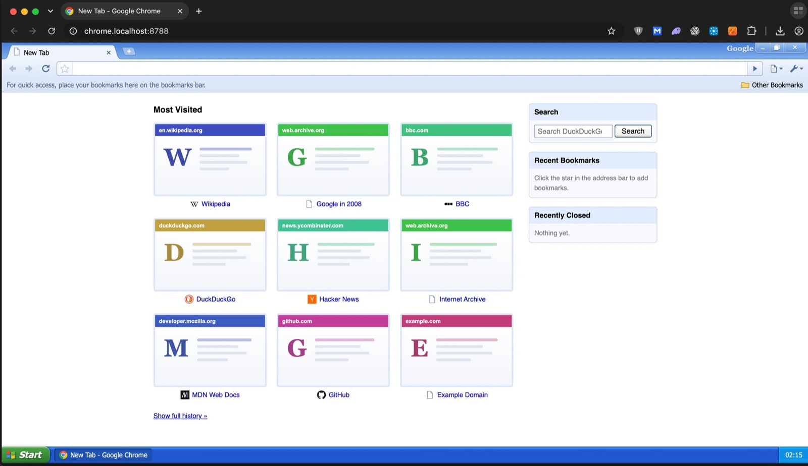
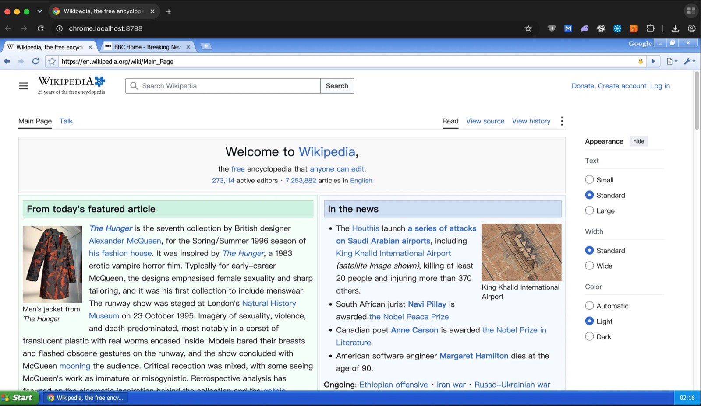
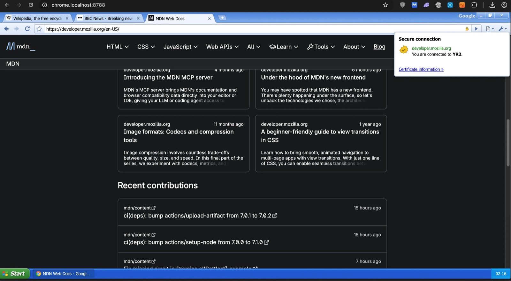
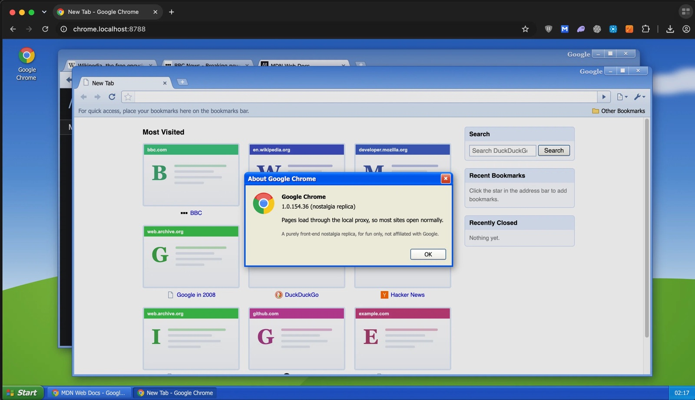

# Chrome XP 复刻版

[English](../README.md) · **简体中文**

在浏览器里复刻 Windows XP 上的 Chrome 1.0 界面，而且**能真的上网**：XP 桌面、任务栏、多窗口、标签页、地址栏，点进去就是真网页。



需要 Node.js 20 或更高，没有其他依赖——不用 npm install，装的东西为零。

> 仅供学习和怀旧，与 Google 没有任何关联。

## 怎么跑起来

**第一步：装 Node.js**（已装可跳过）——  https://nodejs.org/ 或 `brew install node`

**第二步：下载本项目** ——  `git clone https://github.com/kintsink/chromexpage.git`，或点右上角 **Code → Download ZIP** 解压

**第三步：双击对应系统的启动脚本**

| 系统 | 双击这个文件 |
|---|---|
| macOS | `start-macos.command` |
| Windows | `start-windows.bat` |
| Linux | 终端里运行 `bash start-linux.sh` |

浏览器会自动打开 **http://chrome.localhost:8787/** 。看到带任务栏的 XP 桌面就算跑起来了。
关掉终端窗口（或按 Ctrl+C）即停止服务。

<details>
<summary>不想用脚本，或者想换端口</summary>

```bash
node server.js                  # http://localhost:8787/
PORT=9000 node server.js        # 换端口
```

三个启动脚本跑的都是 `node server.js --launch`：它会启动服务；服务已经在跑就复用；端口被别的程序占用就往后换
（最多试 20 个）；监听成功后打开默认浏览器。

如果 `chrome.localhost` 打不开，换 http://localhost:8787/ 。Safari 可能解析不了 `*.localhost` 子域名，会退回
无代理模式；建议用 Chrome、Edge 或 Firefox。
</details>

## 功能

- XP 桌面、任务栏、开始菜单，配上 Chrome 1.0 的标签页、工具栏、书签栏
- 多窗口：拖动、8 向拉伸、最小化 / 最大化 / 关闭，都带动画
- 地址栏建议、后退 / 前进、书签、历史记录、新标签页、缩放
- 锁图标可以查看网站的真实 TLS 证书
- 中英文界面，在「选项」里切换；网站也按界面语言打开
- 「选项」里可清除本地历史记录
- 零依赖：只需要 Node.js 20+

## 启动参数

| 参数 | 说明 |
|---|---|
| `--launch` | 启动器模式（见上） |
| `--log` | 每个代理请求打一行日志 |
| `--allow-private` | 允许代理本机和内网地址。被代理网页里的脚本因此也能访问你**本机上跑着的服务**，不只是内网主机，慎用 |
| `PORT=…` | 端口（`--launch` 时为起始端口） |

macOS 和 Linux 启动脚本还支持 `CX_LOG=1` 打开日志。

## 工作原理

```
浏览器
  └─ http://chrome.localhost:8787/                       界面（index.html）
       └─ <iframe> http://example.com.https.chrome.localhost:8787/
            └─ server.js ──fetch──> https://example.com/
```

- 每个网站映射到自己的 `*.chrome.localhost` 子域名，相对路径、Cookie、localStorage 都按网站隔离。
  例：`https://example.com/` → `http://example.com.https.chrome.localhost:8787/`，
  `http://localhost:3000/` → `http://localhost.p3000.http.chrome.localhost:8787/`
- 代理去掉 `X-Frame-Options`、CSP 等禁止嵌入的响应头，并改写重定向和 Cookie 域名。
- 往每个 HTML 页面注入一小段桥接脚本，通过 `postMessage` 把地址、标题、图标、悬停链接、新窗口请求告诉界面；
  界面只接受来自 `*.chrome.localhost` 的消息。
- 内联脚本里的 `top.location` / `parent.location` 会改写成 `window.location`，让"跳出框架"式的跳转页留在标签页里。

## 截图

| 浏览真实网页 | 证书查看器 |
|---|---|
|  |  |

| 多窗口与关于对话框 |
|---|
|  |

## 安全

- 服务只监听 `127.0.0.1`，界面只响应 `localhost` / `127.0.0.1` / `chrome.localhost`（防 DNS 重绑定）。
- 默认拒绝代理本机和内网地址。目标域名只解析一次，紧接着的连接复用这次结果，域名来不及在"检查"和"连接"之间
  改答内网地址。
- 证书查询接口（`/?cert=`）要带上界面页里现发的令牌，不带就 403；跨域读取只开放给界面自己的域名。它返回的是真
  证书字段，所以不能让别的程序或网页借它当端口探针。
- `/__ping` 同样要令牌，只有本服务发出的界面能探测到代理。别的程序打开同一个地址，拿到的页面没有令牌，会退回
  "无代理"模式，不会借用你的代理。
- 被代理的网页运行在 iframe 沙箱里，不能把整个界面导航走。

### 界面令牌

界面页每次打开都会拿到一个新令牌，写进页面（`<html data-cx-token="…">`），服务只认自己发出的令牌。上一个页面
的令牌在你重开界面后失效；保留最近 8 个，所以同时开多个界面标签页不会互相挤掉。

这就是"只有本服务发出的界面能用代理"的实现方式：任何别的程序、以及任何网页，都拿不到这个令牌。

## 已知限制

- **谷歌**：谷歌会把代理的请求判成异常流量并弹验证码，而验证码不支持 `*.chrome.localhost`，所以谷歌首页和搜索页
  改为不经代理、直接嵌入（谷歌允许带 `igu=1` 时被嵌入）。搜索本身完全正常；但从结果点进去的网站也不经代理：
  允许被嵌入的（如维基百科）能正常显示，禁止被嵌入的（如 Reddit）会显示打不开，地址栏也不会跟着变。
  按住 Cmd/Ctrl 点击结果可在浏览器新标签页打开。
- **其他搜索引擎**：DuckDuckGo（默认）、百度、必应走代理；频繁搜索时 DuckDuckGo 可能弹验证。
- **同一进程**：网页和界面在同一个浏览器进程里，网页脚本跑飞时界面也会卡住。
- **单页应用和登录**：依赖跨站 Cookie、Service Worker 或 WebSocket 的网站可能不完整。
- **Safari**：可能无法解析 `*.localhost` 子域名，会退回无代理模式。建议用 Chrome、Edge 或 Firefox。
- **新标签页缩略图**：按域名生成的示意图，不是真实截图。
- **切换语言**会刷新界面，已打开的标签页会关闭。

## 文件

```
server.js              本地服务：界面 + 代理 + 证书查询
index.html             整个界面（HTML + CSS + JS，单文件）
start-macos.command    macOS 启动器
start-windows.bat      Windows 启动器
start-linux.sh         Linux 启动器
LAUNCHERS.md           启动脚本说明
LANGUAGES.md           多语言说明
CHANGELOG.md           更新日志
LICENSE                MIT 许可证
docs/                  简体中文文档（本文件在这里）
docs/screenshots/      本 README 用到的截图
```

## 测试情况

- `node --check` 覆盖两个源文件；界面脚本也单独做过语法检查。
- 服务端的地址映射、Cookie 改写、桥接注入、错误码、令牌校验等纯函数有 94 条断言。
- 代理链路用真实请求跑过：二进制文件（PNG）经代理与直连结果逐字节一致、`Range` 返回 206、重定向与
  `Set-Cookie` 改写、内网目标被拒。
- 界面用无头 Chrome 驱动跑过：新标签页、浏览、锁图标、证书对话框、错误页、多窗口、最小化、中英文切换，
  无控制台报错。
- **未测**：Windows 与 Linux 启动器只做了语法检查，没在真机上跑过；Safari 的 `*.localhost` 回退路径没测过。

## 许可

MIT，见 [LICENSE](../LICENSE)。